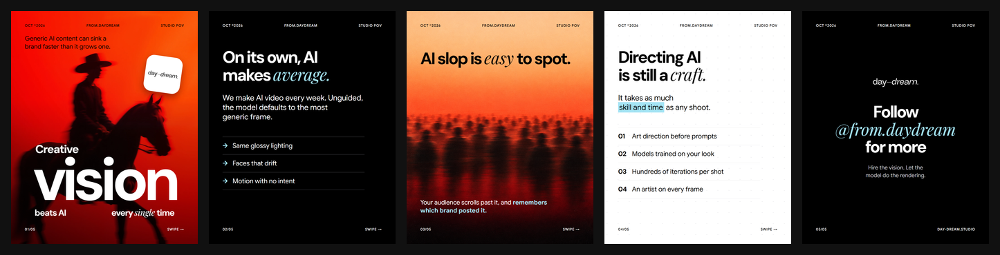
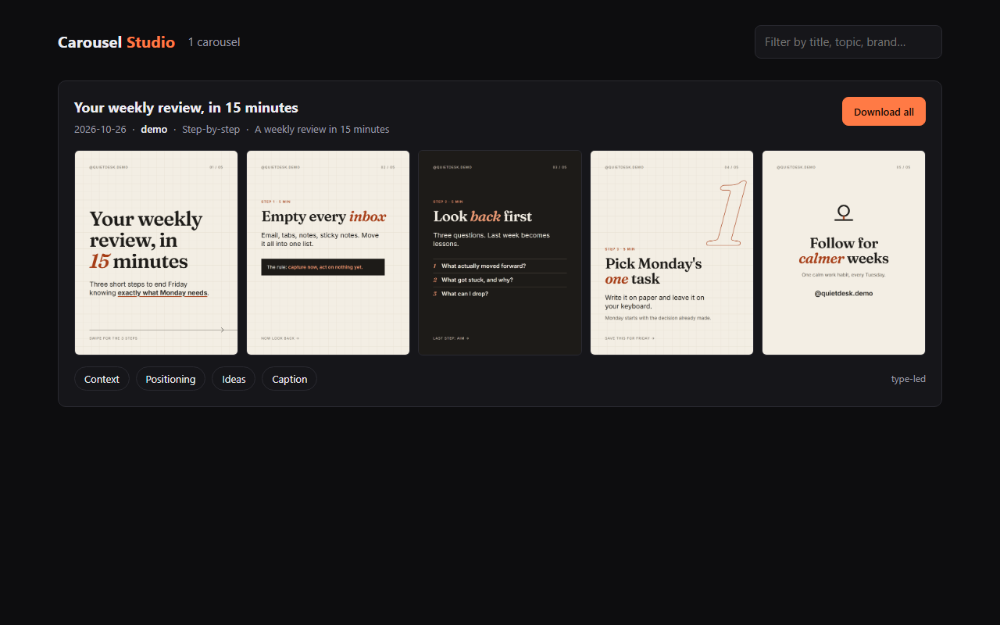
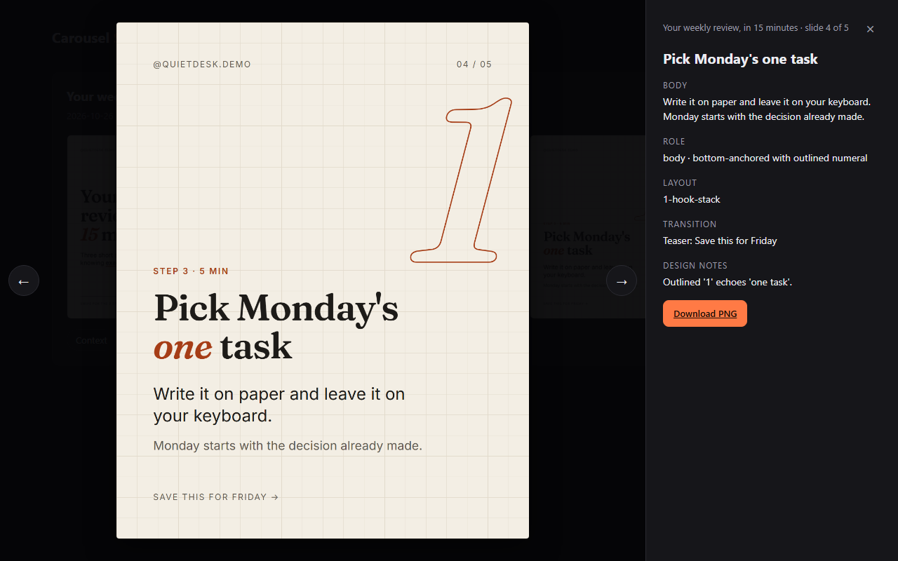

# Carousel Studio

A [Claude Code](https://claude.com/claude-code) skill that turns a topic into a branded 5-slide Instagram carousel: strategy, copy, design, caption and hashtags, rendered to 1080×1350 PNGs with your brand's exact fonts.



- **Runs on your Claude plan.** No Anthropic API key, no backend, no hosted app.
- **Claude designs every slide as HTML.** A local Playwright script renders it with your real font files and checks overflow, safe area, text budgets, hierarchy and contrast before you see it.
- **Built for retention.** A clear hook, one idea per slide, a fixed reading order and a reason to swipe on every slide, checked on every carousel.
- **Images are optional.** GPT Image 2.5 through [fal](https://fal.ai), [Atlas Cloud](https://www.atlascloud.ai) or the [OpenAI API](https://platform.openai.com), or FLUX / FLUX-LoRA on fal. Off by default, so nothing costs money unless you turn it on.
- **A local gallery** for browsing, copying captions and downloading past carousels.

## How it works

1. **Brand setup (once).** Claude interviews you in short batches: positioning, voice, fonts, colours, logo and a written design language. It renders a type specimen and a test slide for you to approve.
2. **Reference layouts (optional, up to 5).** Show Claude posts you like. It turns each one into a measured layout spec in *your* brand's fonts and colours, and you approve a sample slide.
3. **`/carousel-studio <topic>`.** Claude picks a framework (listicle, mistakes, myth vs fact, step-by-step…), writes the narrative spine and slide plan, checks copy against the text budgets, writes the slides, renders them, critiques the PNGs (up to two fix rounds) and hands you the contact sheet, caption and hashtags.
4. **Revise.** "Make slide 3 punchier" or "swap the image on slide 2" touches only that slide.

## Requirements

- Claude Code
- Node.js 18 or newer
- About 300 MB of disk for Playwright's Chromium (installed on first run)

## Install

### As a plugin (recommended)

In Claude Code:

```
/plugin marketplace add from-day-dream/Carousel-Studio-Claude-Skill
/plugin install carousel-studio@day-dream-studio
```

Or from your shell: `claude plugin marketplace add from-day-dream/Carousel-Studio-Claude-Skill`, then `claude plugin install carousel-studio@day-dream-studio`. Run `/reload-plugins` or start a new session to load it.

As a plugin, the slash command is `/carousel-studio:carousel-studio <topic>`. Plain requests like "make a carousel about…" work too. Update with `/plugin marketplace update day-dream-studio`.

### As a standalone skill

Clone this repo into a Claude Code skills directory:

```bash
# Personal: available in every project
git clone https://github.com/from-day-dream/Carousel-Studio-Claude-Skill.git ~/.claude/skills/carousel-studio

# Or per project
git clone https://github.com/from-day-dream/Carousel-Studio-Claude-Skill.git .claude/skills/carousel-studio
```

Start a new Claude Code session so it picks up the skill. The slash command is `/carousel-studio <topic>`.

> **Windows:** if you keep the repo somewhere else, link it with a directory junction instead of a symlink (no admin rights needed):
> `mklink /J .claude\skills\carousel-studio C:\path\to\carousel-studio`

### Dependencies

npm packages and Playwright's Chromium install automatically the first time the skill runs (about a minute). To do it yourself, run `node <skill folder>/scripts/setup.mjs`. With the plugin, the npm packages reinstall after each plugin update, because updates replace the plugin folder. Chromium is shared and stays installed.

## First run

In Claude Code, say:

- **"Set up my brand for carousels"** to start the brand interview, or
- **"Try carousel studio with the demo brand"** to install *Quiet Desk*, a fictional demo brand, and make a carousel straight away.

Then:

```
/carousel-studio 3 mistakes that kill your morning focus
/carousel-studio how to run a 15-minute weekly review, step-by-step, just do it
/carousel-studio pricing myths for freelancers, with images, layout 2
```

Your data lives in `./carousel-studio/` in the current project, or wherever `CAROUSEL_STUDIO_HOME` points. Keeping it outside the skill folder means you can update the skill without touching your brands or carousels.

```
carousel-studio/
├── config.json              active brand
├── .env                     image provider keys (optional, gitignored)
├── providers.json           your model overrides (optional)
├── brands/<slug>/           brand.md, tokens.json, design-language.md, images.json,
│                            fonts/, logo/, layouts/, style-refs/
├── output/<date>-<topic>/   slides/*.html, png/*.png, images/, contact-sheet.png,
│                            meta.json, caption.txt, render-report.json
├── gallery.html
└── index.json
```

## Images (optional)

1. Get a key from [fal](https://fal.ai/dashboard/keys), [Atlas Cloud](https://www.atlascloud.ai) or [OpenAI](https://platform.openai.com/api-keys). OpenAI may ask you to verify your API organization before GPT Image models work.
2. Add it to `carousel-studio/.env` (one is enough):
   ```
   FAL_KEY=...
   ATLAS_CLOUD_API_KEY=...
   OPENAI_API_KEY=...
   ```
3. Ask Claude to turn images on for your brand (it runs one test image first), or just ask for "…with images" on a single carousel.

| Model key | Providers | Notes |
|---|---|---|
| `gpt-image-2.5` (default) | fal, atlas, openai | GPT Image 2.5 Sunburst. Uses your `style-refs/` and earlier slides as references for a consistent set |
| `gpt-image-2` | fal, atlas | Previous generation |
| `flux-dev` | fal | Consistency from a fixed seed and style anchor |
| `flux-lora` | fal | Add your trained style LoRA in `images.json` |

**Changing models.** Endpoints live in [`config/providers.json`](config/providers.json). To switch or add a model without editing the skill, create `carousel-studio/providers.json` with just the parts you want to change. It's deep-merged over the default:

```json
{
  "fal": {
    "models": {
      "my-model": { "kind": "gpt-image", "text": "openai/some-model/text-to-image", "edit": "openai/some-model/edit", "size": [1088, 1360], "quality": "medium" }
    }
  }
}
```

Then set `"provider": "fal", "model": "my-model"` in your brand's `images.json`. `kind` is `gpt-image` (prompt + optional reference images), `flux` or `flux-lora`.

For the OpenAI provider, `text` and `edit` are OpenAI model names. For example, to use the faster Flare tier or pin a snapshot:

```json
{ "openai": { "models": { "gpt-image-2.5": { "text": "gpt-image-2.5-flare", "edit": "gpt-image-2.5-flare" } } } }
```

**Layered images.** For a composed visual (say, a portrait with floating folder icons, then a camera focus bracket on the face), Claude builds the image in up to three passes: a base photo, then up to two edits that each add one group of elements to the previous result. Each pass is saved (`02.pass1.png`…), reviewed, and can be redone on its own ("redo the focus box on slide 2"). Text is still never generated: labels are HTML placed against the finished image. Layering needs a model with an edit endpoint (GPT Image), and each pass is a billed call.

How images behave:
- Off by default. A key alone never turns them on.
- Text, numbers and logos are never generated in images. They're always HTML on top, and every prompt says so.
- If an image fails twice, that slide becomes type-led and the carousel still completes. Fallbacks are listed at the end and shown in the gallery.

## Gallery

```bash
node <skill>/scripts/gallery.mjs --serve
```

Open http://localhost:4173. Claude rebuilds the index after every carousel. A server is needed because browsers block loading the index from a `file://` page.



Each card has the five slides, chips for Context, Positioning, Ideas and Caption (with copy buttons), and **Download all** (PNGs + caption as a zip). Click a slide for a lightbox with its copy, layout, design notes and image prompt. Arrow keys and Esc work.



## Tips

- **Specific design language beats adjectives.** "Headlines in Fraunces 600, sentence case, −2% tracking; accent only on the emphasised word" gets you on-brand slides. "Bold and modern" gets you a template.
- **Choose reference layouts for structure, not style.** The spec keeps the grid, zones and scale contrast and deliberately drops the reference's colours and fonts.
- **Name the framework** if you have one in mind: "myth vs fact", "before/after".
- **Say "just do it"** to skip the plan check-in, or **"quick mode"** for a single critique round.
- **Tighten, don't loosen, the text budgets.** They live in `tokens.json` → `retention`. Claude will warn before loosening them.

## Privacy

Everything runs locally. Your brand kit, fonts, slides and gallery never leave your machine. If you enable images, only the image prompts and any reference images you choose are sent to the provider you picked (fal, Atlas Cloud or OpenAI), under that provider's terms. Rendering uses no network: fonts are embedded from local files.

## What's in the skill

| Path | Purpose |
|---|---|
| `SKILL.md` | Entry point and workflow router |
| `.claude-plugin/` | Plugin manifest and marketplace listing |
| `references/` | Retention framework, design principles, HTML contract, critique rubric, brand setup, layout extraction, image prompting, layered images |
| `scripts/render.mjs` | HTML → PNG, layout and retention report, contact sheet, specimen |
| `scripts/image.mjs` | fal / Atlas / OpenAI image generation, crop, sidecar metadata |
| `scripts/gallery.mjs` | Gallery index and local server |
| `scripts/fonts.mjs` | Download Google Fonts into a brand |
| `scripts/setup.mjs` | Dependency check/install, workspace and brand creation |
| `config/providers.json` | Image model endpoints |
| `templates/` | Empty brand kit, slide skeleton, gallery page |
| `examples/brand-demo/` | Quiet Desk demo brand with a sample carousel |

### Render report checks

Overflow · text outside the safe area or clipped · font size below minimum · non-brand or synthesised fonts · word budgets per level and per slide · exactly one headline, and it's the largest text · at most one emphasis per element · at most 4 list items · swipe cue on slide 1 · text contrast ≥ 4.5:1 measured against the rendered pixels · external URLs · raw colours outside the tokens · broken images. A missing or unloadable brand font stops the render: silent fallback fonts are the most common quality bug.

## Troubleshooting

- **"brand font failed to load"**: a font file is missing, corrupt, or registered with the wrong family name in `tokens.json`. Re-run `scripts/fonts.mjs` or fix the path.
- **"could not launch Chromium"**: run `node <skill>/scripts/setup.mjs`.
- **Gallery says it can't load index.json**: open it through `gallery.mjs --serve`, not by double-clicking the file.
- **Image exit code 4**: a layered image stopped partway. The PNG is built from the last good pass; Claude rebuilds the missing elements in HTML or retries that pass.
- **Image errors with exit code 3**: the key is wrong or out of credit, or the model ID is no longer valid. Check `.env`, or update the model in `providers.json`.

## License

MIT, see [LICENSE](LICENSE). The demo brand's fonts (Fraunces, Inter) are under the SIL Open Font License, see [examples/brand-demo/fonts/FONTS-LICENSE.md](examples/brand-demo/fonts/FONTS-LICENSE.md).
